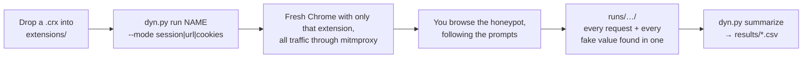
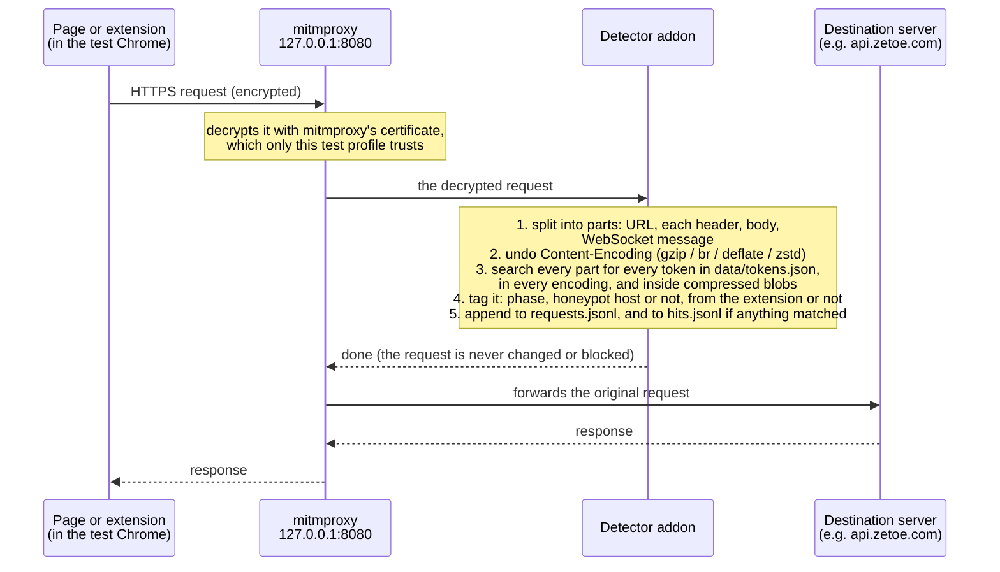

# dynamic-testing-ai-extensions

Find out what a Chrome extension sends out of your browser. Drop in its `.crx`, browse a honeypot
site full of fake sensitive data (SSN, passwords, API keys…), and the harness records every request
and flags any of that data leaving, along with where it went.

Built for a CS 6262 study of GenAI browser extensions, but it works with any extension.
Python 3.10+ (standard library only), mitmproxy, and Chrome for Testing.

> **Status:** being built step by step. `info`, `prepare` and `tokens` work today. `doctor`, `run`
> and `summarize` are next, so the browsing flow below is the plan they implement.

## How it works



Before the browser opens, `run` gets the extension ready:
- **Reads the `.crx`:** its ID, name, version, and a SHA-256 fingerprint of the exact file tested.
- **Unpacks it into `build/`**, adding its public key to the manifest so Chrome loads it under its
  **real store ID**. Without that, sign-in and the extension's own servers can break.
- **Starts Chrome with a brand-new profile:** no cookies or history from earlier runs, only this
  one extension, and Chrome's own background services (sync, updates, QUIC) switched off.

## What happens to each request

Chrome is told to send **all** its traffic through mitmproxy on `127.0.0.1:8080`. That covers
traffic from the web page, from the extension's content scripts running inside that page, and from
the extension's background service worker. So every request the extension makes passes through
the detector before it leaves your machine.



**Step by step:**

1. **Interception.** Chrome connects to mitmproxy instead of the real server. mitmproxy presents a
   certificate signed by its own certificate authority. The test Chrome is started with that
   authority's fingerprint (`--ignore-certificate-errors-spki-list`), so **only this throwaway
   profile** trusts it. Your Mac's keychain and your normal browser are never touched. If a
   connection still can't be decrypted (e.g. an app that pins its certificate), it's logged as
   `tls_failed`, so you know something went by unread.
2. **Decoding.** mitmproxy undoes the body's transport compression (`Content-Encoding: gzip`, `br`,
   `deflate`, `zstd`). The detector then has the URL, each header (including `Cookie` and
   `Referer`), the body, and any WebSocket message the browser sends.
3. **Matching against `data/tokens.json`.** Every fake value on the honeypot (name, email, SSN,
   password, API keys…) is searched for in each part, in each form it could be sent in:

   | Form | Example: SSN `900-12-3456` / name `Mira Holloway` |
   |---|---|
   | plain text, any case | `900-12-3456`, `MIRA HOLLOWAY` |
   | URL-encoded (single or double) | `Mira%20Holloway`, `Mira+Holloway`, `Mira%2520Holloway` |
   | JSON-escaped | `900-12-3456` |
   | hex | `3930302d31322d33343536` |
   | base64, standard or URL-safe, even mid-blob | the SSN inside a base64'd JSON payload in a query parameter |
   | digits only | `900123456`, `2025550147` |
   | inside compressed data | gzip/zlib streams, e.g. session-replay uploads, raw or base64-wrapped |

   Generic values (`123`, `ZZ`, `00000`, the `4111…` test card, the dates) are **weak**: they're
   recorded but never count as a leak on their own, because they also show up by chance.
4. **Tagging.** Each request is labelled with:
   - **phase:** what you were doing at that moment (setup, baseline, passive, active:\<feature\>);
   - **destination:** whether it went to the honeypot itself (expected) or anywhere else;
   - **sender:** whether it came from the extension's own pages or background, via its
     `Origin: chrome-extension://<id>` header.
5. **Recording.** `requests.jsonl` gets one line for **every** request, hit or not, so you also
   get the full list of servers the extension talked to. `hits.jsonl` gets one line per value
   found, e.g.:

   ```json
   {"phase": "passive", "method": "POST", "host": "api.example-ext.com", "location": "body",
    "field": "ssn", "value_kind": "government_id", "strength": "strong", "encoding": "base64@2",
    "is_extension_origin": true, "to_honeypot": false, "context": "…eyJzc24iOiI5MDAtMTItMzQ1NiJ9…"}
   ```

   (Illustrative, not a real result.)
6. **Forwarding.** The request continues to its real destination **unchanged**, so the extension
   behaves normally. The whole session is also saved as `flows.mitm` / `flows.har` to re-check later.

A **leak** is a strong value reaching any host other than the honeypot, outside the setup phase.
`summarize` turns the run folders into tables, and comparing those with store labels or static
analysis is up to you.

**What it can't see:** values that are hashed or encrypted before sending, data the extension
keeps locally, and anything its servers pass on afterwards. A clean run means "not observed",
not "doesn't happen".

## The browsing flow

`python3 dyn.py run <name> --mode <mode>` opens Chrome and prints each step in the terminal.
Timed phases count down by themselves; the others wait for Enter. About 10–15 minutes per run.

| Phase | Time | What you do |
|---|---|---|
| **setup** | as needed | Sign in to the extension with a **throwaway** account and finish its onboarding. Don't open the honeypot yet. Nothing found here counts. |
| **baseline** | 2 min | Sit on example.com. Touch nothing. |
| **passive** | ~3 min | Walk the honeypot flow for the mode (below) **without touching the extension**: no icon, sidebar or popups. Anything sent now went out without you asking. |
| **active** | ~1 min per feature | Type a feature name (`summarize`, `chat`, `select-text`, `autofill`, `translate`…), use that feature on the honeypot page, press Enter. Repeat per feature, then type `done`. |
| **notes** | 1–2 min | Fill in `notes.md`: account used, what didn't work, anything odd. |

Honeypot steps for the passive phase (values are prefilled, so don't edit them):

| Mode | Steps on [quillbert.github.io/honey/](https://quillbert.github.io/honey/) | Puts the fake data in |
|---|---|---|
| `session` | `/session/` → **Log in** → **Continue** → stay on results | form fields, a password box, sessionStorage, page text |
| `url` | `/url/` → **Log in** → **Continue** → stay on results | the page URL (including the password), hidden inputs, page text |
| `cookies` | `/cookies/` → **Set cookies** → `/cookies/read/` → back to `/cookies/` | the browser's cookies |

Run each mode as its own run; each gets a fresh browser profile. Also do one **control run** per
mode, `dyn.py run control --mode <mode>`: the same steps with no extension, so Chrome's own
traffic isn't blamed on an extension.

Extensions that sign in with `chrome.identity.getAuthToken` need branded Google Chrome. `run`
detects this and tells you to load the extension by hand during setup.

## Files

| Path | What it is |
|---|---|
| `dyn.py` | The one command: `info`, `prepare`, `tokens`, then `doctor`, `run` and `summarize` |
| `extensions/` | Drop `.crx` files here. Not committed: they're third-party code. CS6262 copies are in the team Drive |
| `data/tokens.json` | The fake values planted on the honeypot, i.e. what counts as "user data" |
| `dyntest/` | The code behind `dyn.py`, including the mitmproxy addon that scans traffic |
| `tests/` | `python3 -m unittest discover tests` |
| `build/` | Generated: unpacked extensions. Safe to delete |
| `runs/<date>_<name>_<mode>/` | One folder per run: `hits.jsonl` (fake values found), `requests.jsonl` (every request), `phases.jsonl`, `meta.json`, `notes.md`, `flows.mitm` / `flows.har` (full capture) |
| `results/` | Tables from `summarize`: one row per run, every hit, every host contacted |
| `docs/WALKTHROUGH.md` | How each piece works and how it was tested |
| `CONTEXT.md` | Project background |

`runs/` and `results/` are never committed: captures contain test-account cookies and tokens.
Share them through the team's private Drive folder.
