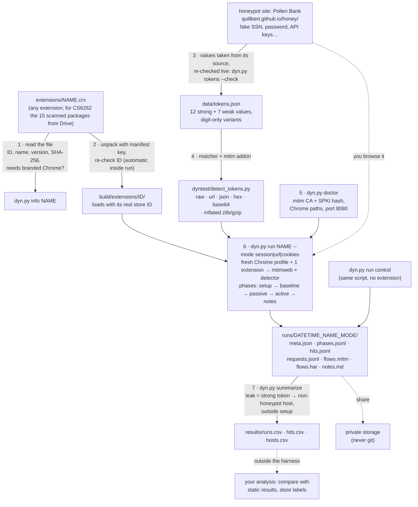

# dynamic-testing-ai-extensions

A dynamic testing harness for Chrome extensions. Drop in an extension's `.crx`, browse a honeypot
page full of fake sensitive data, and see which of those values the extension sends out of the
browser, where to, and how encoded.

It was built for a CS 6262 study of GenAI browser extensions, but works with any extension.
Python 3.10+, standard library only. Needs mitmproxy and Chrome for Testing.

## How it works



## Usage so far

The harness is being built step by step, and this README becomes the full usage guide once `run`
exists. What works today:

```
python3 dyn.py info                      # what the harness reads from each .crx in extensions/
python3 dyn.py prepare zetoe --verify    # unpack with its real ID; prove it in Chrome (network blocked)
python3 dyn.py tokens --check            # the honeytokens; confirm they're still on the live honeypot
python3 -m unittest discover tests       # test suite
```

- `docs/WALKTHROUGH.md` explains each piece: what it does, why, and how it was checked.
- `CONTEXT.md` has the project background.
