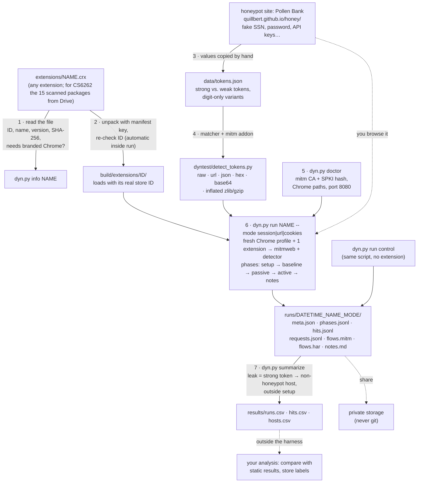

# Walkthrough: how the dynamic testing harness works

This explains the harness one step at a time, in the order it's built: what each piece does,
where its input comes from, how it serves the research question, and what it outputs.
`README.md` is the short tester guide. Background is in `CONTEXT.md` (sections C and D).

**What the harness answers:** when a user visits a page holding sensitive data, does an
extension send that data out of the browser, and if so, which data, where to, how encoded, and
in which phase?

**Method:**
1. Put fake sensitive values (honeytokens) on a page.
2. Run one extension in a clean browser.
3. Record every network request.
4. Search those requests for the fake values.

**Design rule: drop in a `.crx`, run it.** Everything the harness needs comes from the extension
file itself. There's no registry to fill in, no tester names, nothing specific to the CS6262
picks, and no dependency on the static-analysis repo. Comparing results with static predictions
or store labels is analysis you do afterwards. Every run records the extension's ID, version and
file SHA-256, so that comparison is easy to join.

## The flow



## Build order

| Step | Piece | Status |
|---|---|---|
| 1 | Read an extension from its `.crx` (parser + `dyn.py info`) | **done** |
| 2 | Unpack with the manifest `key` so it keeps its real ID (automatic in `run`; `dyn.py prepare` to check it alone) | |
| 3 | `data/tokens.json`: the values the detector looks for | |
| 4 | Detector: encoding-aware matcher + mitmproxy addon, with tests | |
| 5 | `dyn.py doctor`: environment check | |
| 6 | `dyn.py run`: one guided capture | |
| 7 | `dyn.py summarize`: results tables | |
| 8 | `README.md` usage guide | |
| 9 | Self-test: control run plus a pilot on Zetoe or Devi | |

---

## Step 1: Read an extension from its `.crx` file

### What it does
Put a `.crx` in `extensions/`. The file name becomes its label (`extensions/zetoe.crx` → `zetoe`).
Then:
```
python3 dyn.py info               # every .crx in extensions/
python3 dyn.py info zetoe         # one, by file name
python3 dyn.py info mfcncdeeeekkjgonodmcjajafigpgnhh      # or by extension ID
python3 dyn.py info ~/Downloads/other.crx                 # or any path
python3 dyn.py info --brief       # one line each
```
`info` is mostly a check that the file is readable. The same reading happens at the start of
every `run`, and its output goes into that run's `meta.json`.

### What's read from the file, and why each value matters

| Value | Read from | Used for |
|---|---|---|
| `ext_id` | The CRX header's signed `crx_id`, matched to the developer's public key (below) | Loading the extension under its real ID (step 2), and recognising its background requests by `Origin: chrome-extension://<id>` |
| `name`, `version` | `manifest.json`. A placeholder name like `__MSG_appName__` is looked up in `_locales/` | Recorded in the run, so results say exactly what was tested |
| `crx_sha256` | SHA-256 of the whole file | Fingerprint of the exact package. Two runs with the same hash tested the same code |
| `needs_branded_chrome` | Does the manifest have an `oauth2` section? | `chrome.identity.getAuthToken` only works with an `oauth2` section **and** a browser signed in to Google, which Chrome for Testing can't do. So `run` will tell you to use branded Chrome and load the extension by hand. `launchWebAuthFlow` (Gene) needs neither, so it works in Chrome for Testing |
| `manifest_has_key` | Does the manifest already have `"key"`? | If not, step 2 adds one |
| `minimum_chrome_version` | `manifest.json` | `doctor` and `run` can warn if the Chrome build is too old |

For the 15 CS6262 packages, only OG AI comes out as `needs_branded_chrome`. That matches what was
found by hand. Gene has the `identity` permission but no `oauth2` section, so it stays on Chrome
for Testing.

### How the ID is read from a `.crx`
A CRX3 file is `"Cr24"`, a version number, a header length, a protobuf header, then an ordinary
zip of the extension. The header holds:
- **key proofs:** pairs of (public key, signature). A store download has **three**: the
  developer's key plus keys added by the Web Store.
- **`signed_header_data.crx_id`:** the 16-byte extension ID, covered by the signatures.

The extension ID is `SHA-256(public key)[:16]`, written as hex with the digits `0-f` mapped to the
letters `a-p`. The parser picks the one public key whose hash starts with `crx_id`. Step 2 writes
that key into `manifest.json` as `"key"`.

**Why this matters:** without `key`, Chrome gives an unpacked extension a **random ID**. Only
3 of the 15 packages ship with one (AITOPIA, QuestionAI, Spekit). A wrong ID:
- breaks Google sign-in through `chrome.identity`;
- can make backends reject requests from an `Origin` they don't recognise;
- loses the `Origin` header that tells us a request came from the extension rather than the page.

Signatures aren't verified: the file's SHA-256 is recorded instead. CRX2 (the old format: key and
signature lengths, then the zip) is also supported.

### Where the `.crx` files live (not in git)
`extensions/*.crx` is git-ignored. The folder itself is kept, via `.gitkeep`.
- **Size:** 15 packages are 217 MB, git history keeps binaries forever, and every clone pays for them.
- **Ownership:** they're third-party proprietary packages, and committing them redistributes them.

For CS6262, the 15 scanned packages live in the private Drive folder. Use those, not the Chrome Web
Store, which only serves the current version: Merlin, Shizue and Spekit have already changed since
the scan.

### Scaffolding added with this step
- `.gitignore`:
  - Captures (`runs/`, `results/`, `*.mitm`, `*.har`, `hits.jsonl`, `requests.jsonl`) hold the
    test accounts' cookies and tokens, so they never go in git.
  - Generated folders: `build/`, `profiles/`.
  - Extension packages: `extensions/*.crx`.
- `CLAUDE.md`: imports `CONTEXT.md` and lists the repo rules.
- Code layout: `dyn.py` is the only command and stays thin. Logic lives in `dyntest/`:
  - `crx.py`: CRX parser, standard library only;
  - `extension.py`: finds a file by path, name or ID, and describes it.
- Tests: `python3 -m unittest discover tests`.

### How it was checked
`tests/test_crx.py` (13 tests, all passing):
- **ID mapping:** a known hash maps to the expected 32-letter ID.
- **Synthetic CRX3 with a decoy key before the developer's key:** the parser picks the right key,
  ID and `key` value, resolves the localised name, and hashes the whole file.
- **Errors:** wrong magic, a truncated header, and no key matching `crx_id` all fail clearly.
  CRX2 is parsed.
- **Finding files:** by path, by name with or without `.crx`, and by ID. A missing file gives a
  clear error. `describe` flags an `oauth2` manifest as needing branded Chrome.
- **Every `.crx` in `extensions/`:** the header's `crx_id` agrees with the chosen key, and the
  manifest reads. This test is skipped if the folder is empty.

Independent cross-check: for all 15 CS6262 packages, the ID, version, SHA-256 and name read from
the files alone matched what the static scan recorded when it downloaded them.
